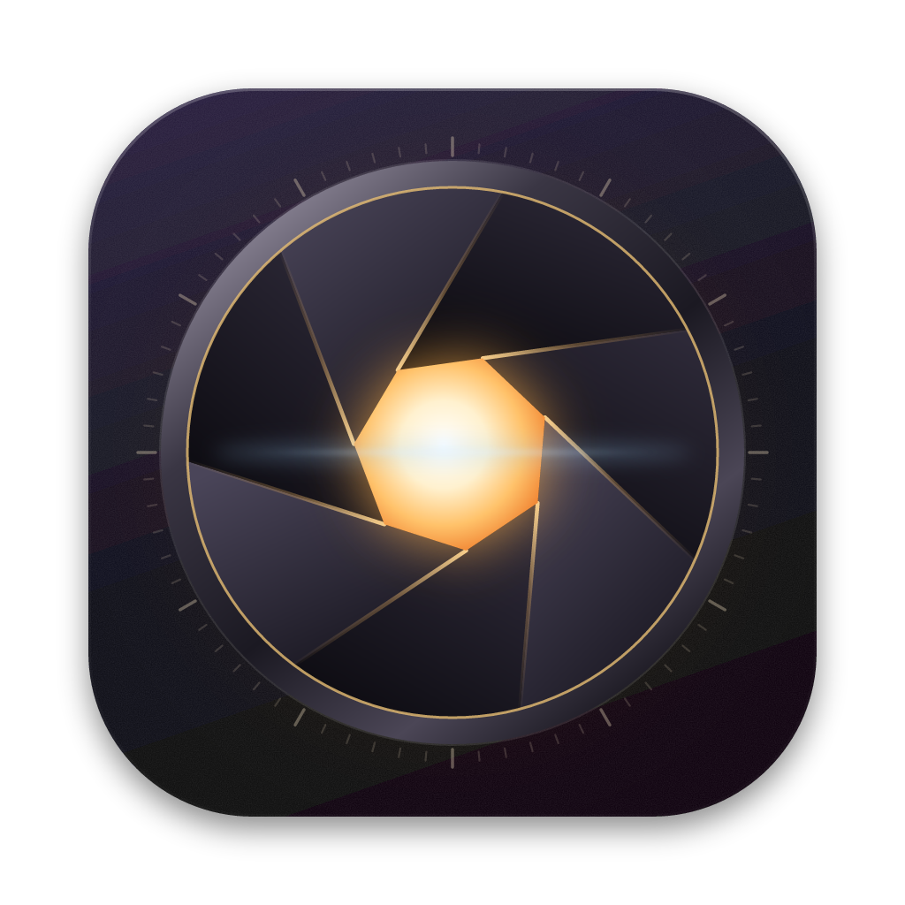

# Iris

Iris is a personal archive for your critiques of movies, shows and games. Every work gets ten scores out of 100, a rating out of 1000 and a class from Terrible to Masterpiece, all set inside a moving, cinematic world you can change whenever you like.

<p align="center"></p>

## Download

| Computer | File |
|---|---|
| Mac with Apple silicon (M1, M2, M3, M4) | [Iris-mac-arm64.dmg](https://github.com/ronikssingh/iris/releases/latest/download/Iris-mac-arm64.dmg) |
| Windows 10 or 11, installer | [Iris-Setup-win-x64.exe](https://github.com/ronikssingh/iris/releases/latest/download/Iris-Setup-win-x64.exe) |
| Windows 10 or 11, no install | [Iris-Portable-win-x64.exe](https://github.com/ronikssingh/iris/releases/latest/download/Iris-Portable-win-x64.exe) |

Every version is listed on the [Releases page](https://github.com/ronikssingh/iris/releases).

### Installing on a Mac

1. Open `Iris-mac-arm64.dmg` and drag Iris into Applications.
2. Open Iris from Applications. Because it isn't from the App Store, macOS stops it the first time and says it can't verify the developer. Click **Done**.
3. Open **System Settings**, go to **Privacy & Security**, scroll down to the message about Iris and click **Open Anyway**. Confirm with your password or Touch ID.

You only do this once. If macOS ever says Iris "is damaged", run this in Terminal and open it again:

```
xattr -dr com.apple.quarantine /Applications/Iris.app
```

### Installing on Windows

Run the installer. If SmartScreen says "Windows protected your PC", click **More info**, then **Run anyway**. The portable version runs without installing anything.

## What's new in 1.1

- **For You:** swipe through well-known movies, shows and games picked from what you rate highly. Right adds it to Up Next, left skips it, up marks it as already seen.
- **Friends:** make a profile with one of sixteen pictures or your own, add friends by username, see their new critiques, like and reply, compare your scores and taste, and send each other titles.
- **Automatic details:** start typing a title and pick the match to fill in the poster, credits, cast and description, from TMDB for movies and shows and IGDB for games.
- **Six new worlds:** Sundown, Frostkeep, Moonspire, Hanami, Lagoon and Hollow Pines.

Friends see every critique except the ones you hide (open a critique, choose More, then Hide from friends). Signing in is optional; without it everything stays on your computer.

## Your critiques are safe

- Everything lives on your computer, in `~/Library/Application Support/Iris` on a Mac and `%APPDATA%\Iris` on Windows.
- Every change is written so a crash or power cut can't leave a half-saved file, and the previous copy is always kept.
- Iris takes a snapshot when it opens, every 15 minutes while you work and when it closes. It keeps the 40 newest, one a day for 90 days and one a month after that. Restore any of them from **Settings → Backups**.
- For copies off your computer, choose a backup folder in **Settings → Backups**. iCloud Drive, OneDrive, Google Drive or a USB drive all work. Iris writes a full `.irisbackup` file there, posters included, whenever you close it after making changes and every few hours while it's open.
- Double-click any `.irisbackup` file to bring it into Iris. You can add it to your library or replace everything with it, and a snapshot is taken first either way.
- Deleted critiques wait in **Recently deleted** for 30 days.

## Coming from Marquee

Iris replaces Marquee. The first time it opens, it finds your Marquee critiques, watchlist and posters on the same computer and brings them across. Nothing in Marquee is changed. The last Marquee builds are still in this repository's history, at [commit 1ddddb1](https://github.com/ronikssingh/iris/tree/1ddddb1dbef205220b937c4a653357e801da30ae).

## Building it yourself

You need Node.js 22 or newer.

```
npm ci
npm start          # build and run
npm test           # unit tests
npm run dist:mac   # Mac app in release/ (run on a Mac)
npm run dist:win   # Windows installer in release/ (run on Windows)
npm run icons      # redraw the app icon and the disk image background
```

The online features need a few keys, kept as GitHub secrets (`TMDB_TOKEN`, `IGDB_CLIENT_ID`, `IGDB_CLIENT_SECRET`, `SUPABASE_URL`, `SUPABASE_ANON_KEY`); [supabase/README.md](supabase/README.md) explains the one-time setup. Without them Iris still works, just without the online parts.

When the version in `package.json` changes and the change reaches `main`, GitHub builds the Mac and Windows versions and publishes them as a new release.
